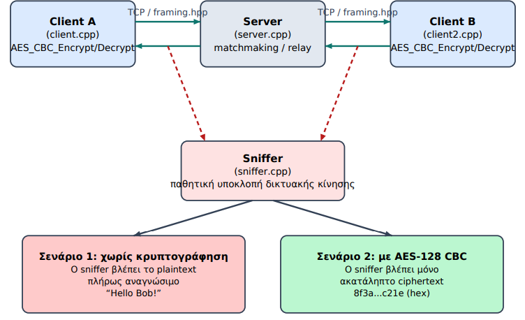
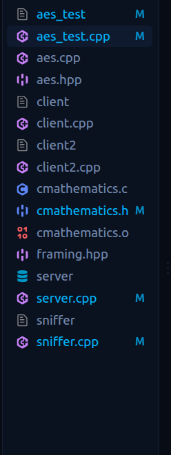
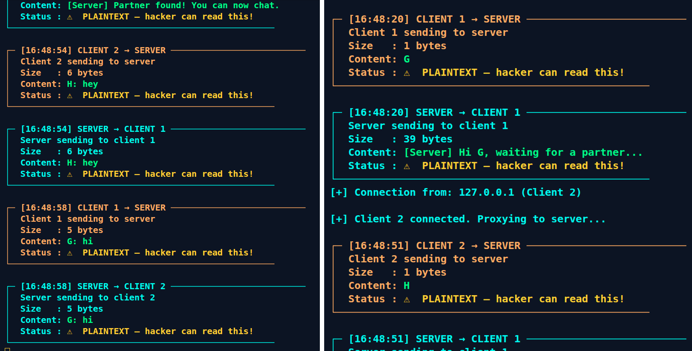
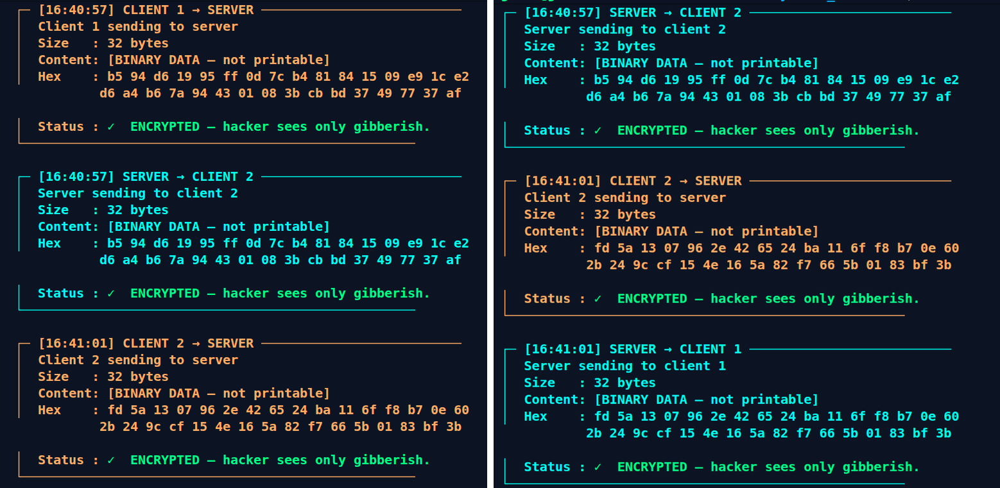
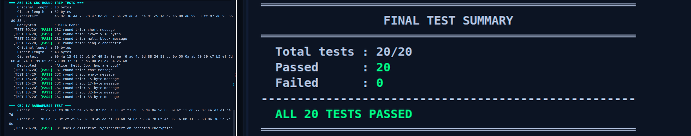
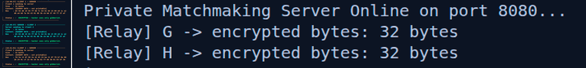

# Secure Communication Software — AES-128-CBC Client/Server

This repository contains the **software part of the thesis project**. The goal of the software is to show how AES encryption can be integrated into a small TCP communication system and, at the same time, make the difference between plaintext and encrypted traffic directly observable.

The implementation is written in C/C++ and includes:

- a custom AES-128 implementation;
- CBC mode with PKCS#7 padding;
- a new random IV for every encrypted message;
- two TCP clients and a relay server;
- a length-prefixed framing layer for binary-safe TCP communication;
- plaintext clients used as a comparison case;
- a controlled MITM/sniffer proxy used to inspect the traffic;
- a 20-test verification program for the AES/CBC implementation.

The FPGA/Verilog part of the thesis is intentionally not covered here.

---

## System architecture

The communication system is built around two clients and one central server. The clients perform the encryption and decryption locally, while the server is only responsible for pairing the users and relaying the data between them.

The sniffer is placed between the clients and the real server. In the thesis setup the clients connect to port **8081**, where the proxy is listening, and the proxy forwards the traffic to the real server on port **8080**.



This setup makes it possible to run the same communication in two modes:

- with the plaintext clients, where the intercepted message is directly readable;
- with the encrypted clients, where the proxy sees the message length and the binary payload, but not the original chat text.

---

## Project files

The project is split into small modules so that the cryptographic code, TCP framing and application logic can be tested independently.



| File | Purpose |
|---|---|
| `aes.hpp` | Public declarations and AES constants |
| `aes.cpp` | AES-128 core, key expansion, CBC mode, PKCS#7 and IV handling |
| `cmathematics.c/.h` | Small C helper module used by the AES code |
| `framing.hpp` | Length-prefixed TCP framing and binary-safe send/receive helpers |
| `server.cpp` | Matchmaking and relay server, port 8080 |
| `client.cpp` | First encrypted client |
| `client2.cpp` | Second encrypted client |
| `client_plain.cpp` | Plaintext version of the first client |
| `client2_plain.cpp` | Plaintext version of the second client |
| `sniffer.cpp` | MITM TCP proxy, port 8081 |
| `aes_test.cpp` | AES/CBC verification suite |

---

## Message flow

For an encrypted chat message, the sequence is straightforward:

1. The client adds the sender name to the message.
2. `AES_CBC_Encrypt()` pads the message with PKCS#7.
3. A fresh 16-byte IV is read from `/dev/urandom`.
4. The padded message is encrypted with AES-128-CBC.
5. The IV is placed in front of the ciphertext.
6. `sendMsg()` adds a 4-byte length prefix and sends the complete binary frame.
7. The sniffer forwards the frame unchanged to the server.
8. The server relays the same frame to the second client.
9. The receiving client extracts the IV, decrypts the ciphertext and removes the padding.
10. The recovered message is printed to the terminal.

The server never needs the AES key and does not decrypt chat messages.

---

# AES implementation

## `aes.hpp` and `aes.cpp`

The cryptographic part is kept separate from the networking code. `aes.hpp` exposes the functions used by the clients and by the test program, while `aes.cpp` contains the actual implementation.

The software uses **AES-128**, so the basic parameters are:

- block size: 128 bits / 16 bytes;
- key size: 128 bits / 16 bytes;
- number of rounds: 10;
- expanded key: 44 words of 32 bits, equivalent to 11 round keys.

The high-level functions used by the application are `AES_CBC_Encrypt()` and `AES_CBC_Decrypt()`. The lower-level AES functions remain available because they are tested separately in `aes_test.cpp`.

### AES state

Each 16-byte block is converted to the 4×4 AES state matrix before the round operations are applied. The helper functions in `aes.cpp` convert between the linear 16-byte representation used by the application and the internal column-major AES state.

### SubBytes

`subBytes()` applies the AES S-box to each byte of the state. The S-box is stored as a fixed 256-entry lookup table. `invSubBytes()` uses the inverse table during decryption.

This is the nonlinear stage of AES and is the part that provides the main confusion property of the cipher.

### ShiftRows

`shiftRows()` rotates the rows of the state by different offsets. No arithmetic is performed here; the bytes are simply moved to new positions. `invShiftRows()` reverses the same operation during decryption.

### MixColumns and GF(2^8)

`mixColumns()` processes each column of the state using arithmetic in the finite field GF(2^8). The multiplications are carried out by `gf_multiply()`, using the AES irreducible polynomial associated with `0x11B`.

The inverse operation, `invMixColumns()`, uses the corresponding inverse coefficients and the same finite-field multiplication routine.

### AddRoundKey

`addRoundKey()` XORs the 128-bit state with the round key. The operation is used in both directions because XOR is self-inverse.

### Key expansion

`keyExpansion()` expands the original 128-bit key into 44 32-bit words. These words form the initial key and the ten round keys required by AES-128.

The key schedule uses the standard AES operations `rotWord()`, `subWord()` and the round constants stored in `RCON`.

### Block encryption and decryption

`AES_EncryptBlock()` operates on exactly one 16-byte block. It performs the initial AddRoundKey, nine full AES rounds and the tenth/final round without MixColumns.

`AES_DecryptBlock()` applies the inverse sequence with the round keys in reverse order.

The block functions are intentionally independent of CBC mode, which makes it possible to verify the AES core directly with known test values.

---

# CBC mode

The chat application uses AES in **Cipher Block Chaining (CBC)** mode rather than encrypting each 16-byte block independently.

Before encryption, `AES_CBC_Encrypt()` applies PKCS#7 padding so that the plaintext length is a multiple of 16 bytes. A new 16-byte IV is then generated from `/dev/urandom`.

For the first block, the plaintext is XORed with the IV before AES encryption. Every later block is XORed with the previous ciphertext block. The function returns one binary buffer containing the IV followed by the ciphertext.

`AES_CBC_Decrypt()` performs the opposite operation. It reads the first 16 bytes as the IV, decrypts the ciphertext blocks, performs the CBC XOR step and finally validates and removes the PKCS#7 padding.

A fresh IV means that encrypting the same message twice with the same key does not normally produce the same complete output. This behaviour is also checked by the test program.

---

# TCP framing

## `framing.hpp`

TCP transports a stream of bytes; it does not preserve application message boundaries. A single `send()` can therefore arrive through more than one `recv()`, or several sends may be available together.

`framing.hpp` solves this by placing a 4-byte length field in front of every payload.

`sendMsg()` sends the length in network byte order and then sends the full payload. `recvMsg()` first reads the length and then waits until the declared number of bytes has been received.

The helper functions `sendAll()` and `recvAll()` deal with partial sends and partial reads. Because the payload is stored in `std::string`, the same framing code can carry both readable text and AES ciphertext containing zero bytes.

---

# Relay server

## `server.cpp`

The server listens on TCP port **8080**. Its role is deliberately simple: pair two users and relay frames between them.

When the first client connects, it is stored as the waiting client. When the second client arrives, the two sockets are linked and both users are notified that a partner has been found.

After the pairing, the chat loop reads a complete framed message from one socket and writes the same payload to the partner socket. The server prints the size of encrypted messages, but does not call the AES decryption functions.

Messages generated by the server itself begin with `[Server]` and are sent as plaintext status/control messages.

---

# Encrypted clients

## `client.cpp` and `client2.cpp`

The two encrypted clients use the same application logic and the same 128-bit AES key. In the thesis demonstration the key is embedded directly in the source so that both clients can encrypt and decrypt each other's messages.

The clients connect to port **8081**, which is the sniffer/proxy. They do not connect directly to the relay server.

After connecting, each client sends its user name so that the relay can perform the pairing. Normal chat messages are formatted with the sender name and then passed to `AES_CBC_Encrypt()` before transmission.

A receive thread waits for incoming frames. Payloads beginning with `[Server]` are treated as server notifications. Every other payload is passed to `AES_CBC_Decrypt()` and the recovered plaintext is displayed.

---

# Plaintext comparison clients

## `client_plain.cpp` and `client2_plain.cpp`

The plaintext clients use the same framing and networking logic but skip the AES calls completely. A formatted message is sent directly through `sendMsg()` and received data is printed without decryption.

These clients exist only to provide the comparison case used in the interception experiment.

---

# Sniffer / MITM proxy

## `sniffer.cpp`

`sniffer.cpp` is a controlled TCP proxy used to make the effect of encryption visible. It listens on port **8081** and creates a second connection to the real server on port **8080**.

For each direction, the proxy reads the complete framed message, logs it and forwards the same bytes to the destination. It does not alter the payload.

The program uses a simple printable-character check for the demonstration output. Readable payloads are displayed directly; binary payloads are shown as hexadecimal bytes.

### Without encryption

With the plaintext clients, the application message can be read directly by the proxy.



### With AES-128-CBC

With the encrypted clients, the same proxy still sees the connection and the frame size, but the chat payload is binary ciphertext.



This is an important distinction: encryption does not hide the existence of the traffic. It protects the **content** of the message. Timing, connection information and message sizes remain observable.

---

# Verification

## `aes_test.cpp`

The AES implementation is checked independently from the networking code. The test program contains 20 checks covering the main parts of the cryptographic module:

- GF(2^8) multiplication;
- AES-128 key expansion;
- one-block encryption;
- one-block decryption;
- CBC round trips for several message lengths;
- padding cases around the 16-byte block boundary;
- empty and short messages;
- repeated encryption with a different IV.

The current source passes all 20 tests.



The communication test also confirms that encrypted frames are successfully relayed by the server while remaining unreadable to the proxy.



---

# Building

The project targets a Linux/POSIX socket environment. A C++17 compiler, GCC and pthread support are enough to build it.

Compile the C helper first:

```bash
gcc -c cmathematics.c -o cmathematics.o
```

Build the AES test program:

```bash
g++ -std=c++17 aes_test.cpp aes.cpp cmathematics.o -o aes_test
```

Build the relay server and proxy:

```bash
g++ -std=c++17 server.cpp -pthread -o server
g++ -std=c++17 sniffer.cpp -pthread -o sniffer
```

Build the encrypted clients:

```bash
g++ -std=c++17 client.cpp aes.cpp cmathematics.o -pthread -o client
g++ -std=c++17 client2.cpp aes.cpp cmathematics.o -pthread -o client2
```

Build the plaintext clients:

```bash
g++ -std=c++17 client_plain.cpp -pthread -o client_plain
g++ -std=c++17 client2_plain.cpp -pthread -o client2_plain
```

---

# Running the demo

Start the programs in the following order.

**1. Relay server**

```bash
./server
```

**2. Sniffer / MITM proxy**

```bash
./sniffer
```

**3. Two encrypted clients, each in a different terminal**

```bash
./client
./client2
```

The clients use `127.0.0.1` by default and connect through the proxy on port 8081.

To repeat the experiment without encryption, stop the encrypted clients and run:

```bash
./client_plain
./client2_plain
```

The AES tests can be run independently with:

```bash
./aes_test
```

---

# Security notes

This is a thesis/educational implementation, not a production communication protocol.

**Static shared key.** The AES key is embedded in both encrypted clients. No key-exchange mechanism is implemented.

**CBC does not authenticate messages.** AES-CBC provides confidentiality, but the current protocol does not include a MAC or authentication tag. A natural extension would be an authenticated mode such as AES-GCM.

**IV handling.** A new 16-byte IV is generated from `/dev/urandom` for every encryption and is transmitted together with the ciphertext.

**Control messages.** `[Server]` messages are intentionally left in plaintext because they are used by the application for connection and pairing status.

**Visible metadata.** The proxy can still observe connection timing, direction, frame size and ciphertext bytes even when the chat content is protected.

**Sniffer classification.** The printable/non-printable test used by `sniffer.cpp` is only a visual aid for the demonstration. It is not a cryptographic detector.

---

## Summary

The software separates cryptography from networking: AES-128-CBC protects the chat payload at the clients, `framing.hpp` transports binary messages safely over TCP, `server.cpp` relays those messages without decrypting them, and `sniffer.cpp` demonstrates the practical difference between plaintext and encrypted communication.
